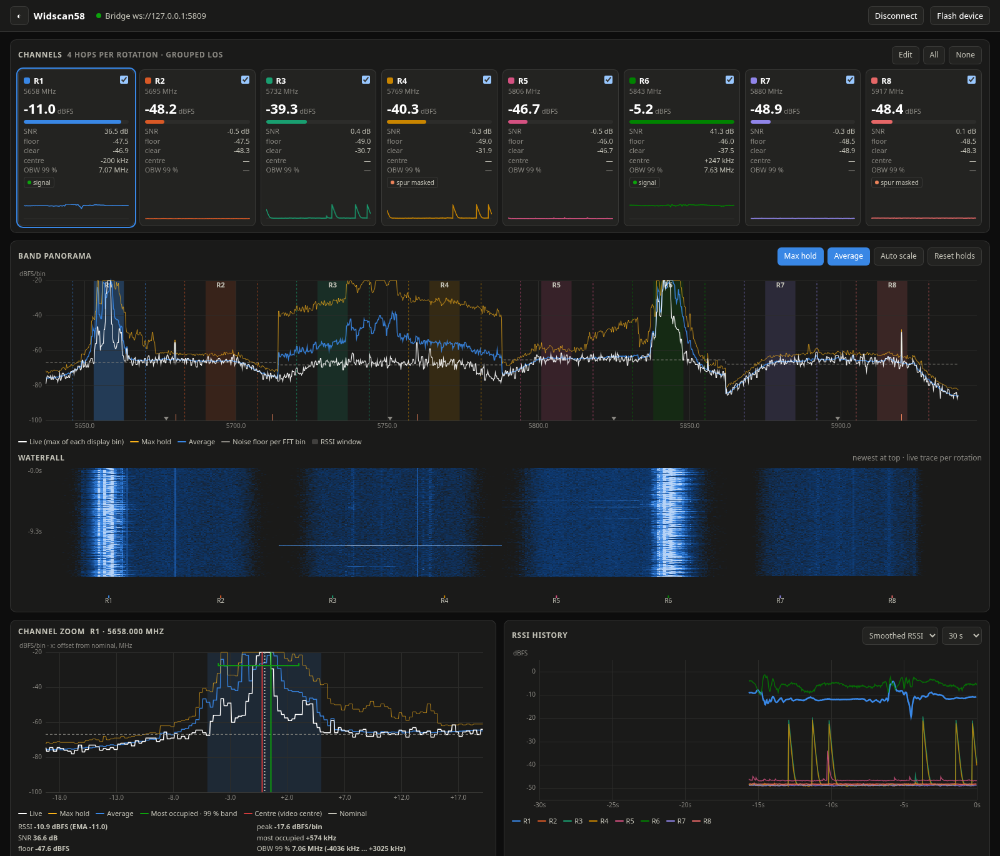
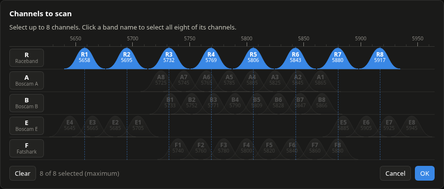

# Widscan58

**A 5.8 GHz FPV channel scanner made from an ESP32-C5.**

Widscan58 uses the Wi-Fi radio inside the ESP32-C5 as a software-defined radio.
Instead of decoding Wi-Fi, it reads raw I/Q samples straight from the radio,
steps through FPV video channels, and shows what is on each one: signal
strength, noise floor, SNR, where the video signal actually sits, and a live
spectrum of the whole band. Use it at the field to find a clear channel, check
pilot VTX frequencies, or see who is stepping on whom.

There is nothing to install. The dashboard runs in your browser and talks to the
C5 over USB.

## ▶ [Open the live web UI](https://capnbry.github.io/widscan58/)

**https://capnbry.github.io/widscan58/** (Chrome, Edge or Firefox on desktop,
or Chrome on Android)

*Live from a XIAO ESP32-C5 scanning Raceband: two VTXs on R1 and R6 (SNR 36 and
41 dB), with Wi-Fi bursts around R3–R4. Each channel updates about 50 times a
second.*

## Features

- **Eight channels at once.** Raceband by default, or any eight channels from
  bands A, B, E, F and R. Each one updates about 50 times a second.
- **Per-channel readings:** RSSI, noise floor, SNR, the measured centre of the
  video signal (so you can spot a VTX that is off frequency), and the 99 %
  occupied bandwidth.
- **Band panorama:** one spectrum stitched together across the whole band, with
  max-hold and average traces, plus a waterfall underneath.
- **Channel zoom:** a close-up spectrum of the selected channel with markers for
  the nominal frequency, the measured centre and the occupied band.
- **RSSI history:** a lap-timer style graph of every channel over the last 30 s
  or more.
- **Channel editor:** pick your channels on a frequency chart that looks like
  the usual FPV band charts, or select a whole band with one click.
- **Flash from the browser:** the page installs the firmware on the board, so you
  don't need a toolchain.
- **Simulator:** press *Simulate* to try the whole UI without any hardware.
- **Record and replay** a session to a file.
- **RotorHazard timer node:** switch the page (☰ menu) to RotorHazard mode and
  the board becomes an 8-seat receiver for [RotorHazard](https://github.com/RotorHazard/RotorHazard)
  lap timing, on one USB port. The page shows each seat's level, lets you set
  the EnterAt/ExitAt thresholds and lists detected passes; then connect the
  board to your RotorHazard server instead (add its port to `SERIAL_PORTS` in
  the server's config).
- **Deep diagnostics** for the curious: hop timing, raw I/Q snapshots with a
  constellation view, scanner settings and a command console.

## Hardware

Widscan58 runs on the **ESP32-C5**, Espressif's dual-band (2.4 + 5 GHz) Wi-Fi
chip. It is developed and tested on the
[Seeed Studio XIAO ESP32-C5](https://wiki.seeedstudio.com/xiao_esp32c5_getting_started/).
Other ESP32-C5 boards work too, such as the C5 devkit.

> The firmware also builds for the ESP32-S3, but the S3 has no 5 GHz radio. It
> runs a scaled-down mock-up of the band at 2.4 GHz and is only used for
> development.

## Getting started

1. Plug the ESP32-C5 into your computer or Android phone over USB.
2. Open the [web UI](https://capnbry.github.io/widscan58/) in Chrome, Edge or
   Firefox on desktop, or Chrome on Android.
3. Click **Flash device** and follow the steps to install the firmware.
4. Click **Connect device** and pick the board. Chrome remembers it, so next time
   it reconnects by itself.

## Credits

Widscan58 would not exist without
**[esp-sdr](https://github.com/ESPARGOS/esp-sdr)** by the
**[ESPARGOS](https://github.com/ESPARGOS)** team. They found the hidden debug
path that lets an ESP32 capture raw I/Q samples from its own radio, and they
published the code that drives it. The radio capture, tuning and calibration
code in this project, and the S3's SIMD FFT, come from or build on their work. If you like this project, go look at theirs: it is a remarkable
piece of reverse engineering, and they are awesome.

This project is almost entirely written by AI apart from the esp-sdr source.

## License

GPL-3.0-or-later (see [LICENSE](LICENSE)), the same as esp-sdr. Files derived
from esp-sdr say so in their headers.

Developers: see [CLAUDE.md](CLAUDE.md) for building, flashing, the tools and the
device protocol, and [PLAN.md](PLAN.md) for the design.
